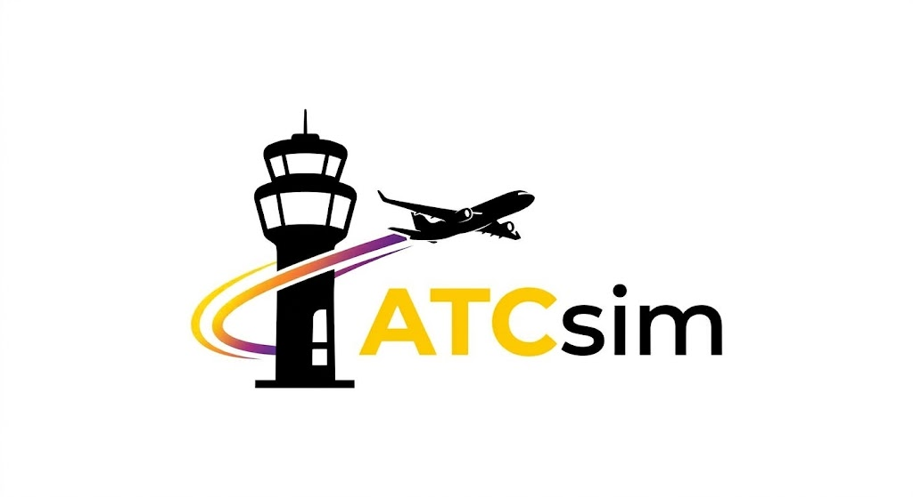

  

<h1 align="center">ATCsim (Air Traffic Control Simulator)</h1>

  <strong>Симулятор диспетчерського контролю та розподілу повітряного руху</strong> 
  <em>Розроблено у межах курсу «Програмна інженерія»</em>

---

## Про проєкт

Зростання щільності повітряного трафіку вимагає ефективних алгоритмів координації та запобігання колізіям. **ATCsim** — це десктопний програмний комплекс для моделювання, візуалізації та аналізу процесів керування повітряним простором.

Система демонструє принципи взаємодії між повітряними суднами і диспетчерськими службами, протоколи радіообміну, а також реакцію системи на зміну зовнішніх метеоумов у режимі реального часу.

## Основний функціонал

* **Інтерактивна навігаційна карта:**
  * Відображення повітряного простору, маршрутів і поточного положення суден.
  * Візуалізація руху літаків у реальному часі з телеметричними даними.

* **Комунікаційний модуль:**
  * Журнал радіообміну між екіпажами літаків та диспетчерськими пунктами.
  * Логування дій, рішень алгоритмів ешелонування та маршрутизації.

* **Керування аеропортовою інфраструктурою:**
  * Відображення повної інформації про аеропорти (статус смуг, доступність).
  * Додавання, модифікація параметрів та видалення вузлів інфраструктури.

* **Контроль та редагування трафіку:**
  * Ручне додавання нових авіарейсів із заданими характеристиками польоту.
  * Коригування поточних маршрутів і параметрів руху.

* **Модуль метеоумов:**
  * Налаштування швидкості та напрямку вітру.
  * Моделювання зон нельотної погоди та погодних аномалій.

## Технічний стек

* **Мова програмування:** C#
* **Платформа:** .NET
* **Графічний інтерфейс:** Windows Presentation Foundation (WPF)

## Системні вимоги та запуск

### Попередні вимоги
* Операційна система: Windows 10 / 11
* Середовище виконання: .NET Desktop Runtime (або встановлений .NET SDK)
* Середовище розробки (для збірки з вихідного коду): Visual Studio 2022 або Rider із підтримкою .NET Desktop Development

### Запуск проєкту

1. Завантажити або клонувати вихідний код проєкту.
2. Відкрити файл рішення `ATCsim.sln` у Visual Studio.
3. Дочекатися відновлення залежностей проєкту.
4. Вибрати конфігурацію збірки `Debug` або `Release`.
5. Запустити проєкт клавішею `F5` або кнопкою `Start` на панелі інструментів.

## Команда розробки

Студенти групи ПМІ-33:
* Безкоровайний Олександр
* Борков Максим
* Рубан Владислава

## Генерація карти за сідом

У верхній панелі введіть ціле 64-бітне число в поле **SEED** і натисніть **↻**.
Кнопка **Random seed** обирає новий сід та одразу створює карту. Після генерації
симуляція стоїть на паузі; натисніть **Run**, щоб почати рух.

Сід визначає берегову лінію, ділянки рельєфу, розташування п'яти аеропортів,
напрямки та довжини смуг, 8–14 навігаційних точок, три погодні зони й початкові
маршрути та параметри восьми літаків. Аеропорти розміщуються на суші з відстанню
щонайменше 110 одиниць карти. Назви аеропортів реальні, але карта є умовною,
а не географічною картою України.

Наприклад, згенеруйте `12345`, потім `98765`, а тоді знову `12345`:
початкові об'єкти й рельєф першої та третьої карти збігатимуться.
Команди диспетчера та час симуляції впливають на подальший рух, а не на генерацію.
Для відтворення використовується власний алгоритм SplitMix64 з усіма 64 бітами сіду.
Сіди попередньої демонстраційної версії створюватимуть нові карти за оновленим алгоритмом.

Згенерований сектор зберігається в SQLite. Команда **Direct to destination**
направляє вибраний літак до аеропорту призначення його згенерованого рейсу.

## Іконки та типи літаків

Логотип із `docs/logo.png` відображається зліва перед полем SEED. Кнопки керування
розташовані праворуч і переносяться на наступний рядок у вузькому вікні.

До пасажирських Boeing 737-800, Airbus A320/A321 та Embraer E195 додано:

- **Ilyushin Il-76TD (IL76)** — вантажний літак.
- **Bombardier Global Express (GLEX)** — бізнес-джет.
- **Cirrus SR22 (SR22)** — легкий гвинтовий літак.

Нові типи доступні в **Add Aircraft** та включені в початковий трафік нової карти.
Збережена сесія зберігає свої літаки; для створення нового змішаного трафіку
згенеруйте карту кнопкою **↻** або **Random seed**.
Після вибору моделі форма підставляє відповідні швидкість і висоту; вручну
відредаговані значення зберігаються при перемиканні моделі.
Команди набору висоти враховують максимальну висоту моделі. Витрата пального
масштабується за місткістю бака як спрощена симуляційна оцінка; інспектор показує
відсоток фактичної місткості та запас часу за тією ж оцінкою.

На карті використовуються окремі векторні силуети пасажирського, регіонального,
вантажного, бізнес- та гвинтового літака. Силует повертається за курсом,
а аеропорти позначені диспетчерською вежею з терміналом.
Літаки накладені безпосередньо на карту без квадратних підкладок. Тонкий світлий
контур забезпечує видимість на темному рельєфі; наведення, вибір та конфлікт
позначаються кільцем навколо силуету. Прозора область натискання зберігається.
Натискання на значок або підпис аеропорту відкриває його інспектор.
Джерела іконок і ліцензії вказано
в [THIRD-PARTY-NOTICES.md](THIRD-PARTY-NOTICES.md).
